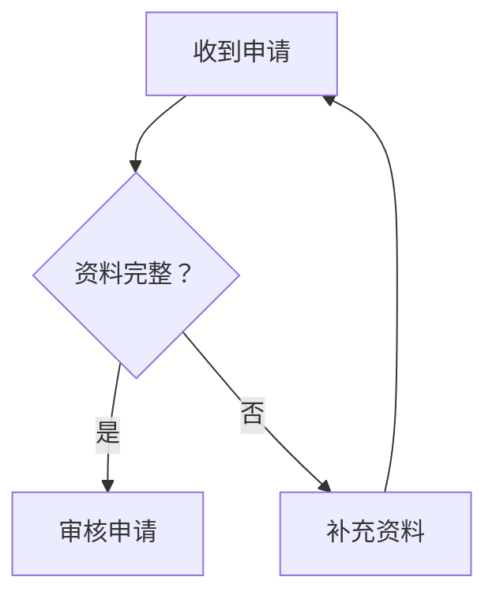
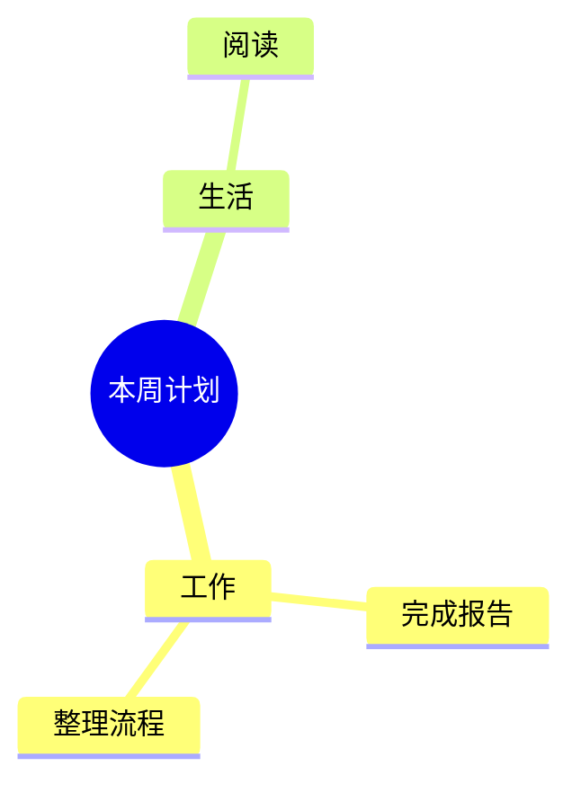

# 用户手册

本页为 v0.1 操作手册初稿；功能仍在开发中，当前完成状态见 [progress.md](progress.md)。

## 日常流程

1. 在外部 AI 工具生成 `flowchart` 或 `mindmap`，复制 Mermaid 代码本体，不含 Markdown 的三个反引号。
2. 粘贴到左侧编辑器，右侧显示预览；直接修改中文文字、连线与结构。
3. 遇到错误时按提示修复。右侧保留最近成功图形，因此可能暂时与当前代码不同。
4. 通过工具栏导出 `.mmd` 保存可继续编辑的源文件；导出 SVG 保存图形。

## 保存与文件

自动保存只在当前电脑、当前浏览器、当前网站地址内生效。不同电脑可以打开同一网站，草稿不会自动跨设备同步。隐私模式、禁用存储、清理浏览器数据或变更网站域名可能让草稿不可用。请经常导出 `.mmd`；在另一设备导入即可继续修改。

切换模板、导入文件或应用大纲会覆盖代码，请查看确认提示并按需保存文件。自动保存失败时应立即导出源码。语法错误也可以保留源码，方便继续修复。

## 常用流程图语法

节点使用稳定的英文 ID，显示文字放进引号。修改文字一般不必修改 ID。



- `A["节点文字"]`：普通步骤；`B{"判断条件？"}`：判断节点。
- `A --> B`：连线；`A -->|通过| B`：带条件文字的连线。
- `TD` 从上往下，`LR` 从左往右；也可使用 `BT`、`RL`。
- `subgraph 分组名称` 到 `end`：把相关步骤放入同一组。
- 工具内语法帮助提供可插入示例。插入后检查节点 ID 是否与现有内容重复。

## 思维导图与大纲



缩进代表父子关系。大纲转换输入只有一个顶格根主题；首个子主题用 2 或 4 个普通空格确定缩进单位，后续每级保持相同单位，也可统一每级用一个 Tab。整个大纲不能混用 Tab 和空格，不能跳级，不能用全角空格。空行会忽略，每行可带 `- ` 或 `* ` 列表标记；错误会标出原文行号。

```text
本周计划
  工作
    完成报告
    整理流程
  生活
    阅读
```

转换后仍可在 Mermaid 编辑器修改。流程图与思维导图各有模板；应用不会把任意流程图自动转成思维导图。

大纲转换上限为 100,000 字符、1,000 个主题、30 层（含根主题）。这些是保护性上限，实际可流畅渲染的规模取决于设备；建议把大型大纲拆成多张图。特殊符号会转换为 Mermaid 文本实体，保留文字而不执行其中的语法。

## 预览与常见问题

- 缩放、平移和适应窗口用于查看整张图；布局由 Mermaid 自动计算，不能像 Draw.io 一样单独拖动节点并固定位置。
- 图不更新：查看语法错误状态，检查括号、引号、节点 ID 和 `mindmap` 缩进；修复后继续预览。
- 刷新后没有草稿：确认使用相同浏览器与网址，检查浏览器是否禁止或清除了本地存储。
- SVG 中中文依赖打开文件设备的可用字体；源码文件采用 UTF-8。
- 超大图可能让浏览器变慢；建议拆成多张图。第一版只保证 `flowchart` 与 `mindmap`。
- 图表在浏览器内处理；本站不调用 AI、不自动上传图表。外部 AI 工具由你自行使用。
