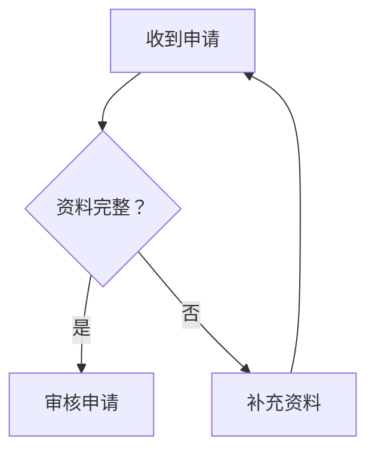
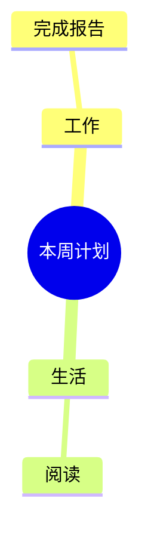

# 绘序使用手册

v0.1.0 已上线：[打开绘序](https://mermaid-live-editor-gamma.vercel.app/)。运行方式见 [README](../README.md)，线上验收与版本状态见 [开发进度](progress.md)，实际验证覆盖见 [验证记录](verification.md)。

## 从一张流程图开始

1. 在外部 AI 工具生成 `flowchart` 或 `mindmap`，复制代码本体，不含 Markdown 的三个反引号。
2. 粘贴到左侧“代码编辑”，右侧自动更新。也可点“流程图”或“思维导图”模板。
3. 修改中文文字、条件、箭头或缩进；上方“图表名称”决定导出文件名。
4. 查看底部“已自动保存到此浏览器”。点击“导出源码”保存 `.mmd`，点击“导出 SVG”保存矢量图。

编辑器提供高亮、行号、撤销重做。可用按钮，或 `Ctrl / ⌘ Z` 撤销、`Ctrl / ⌘ Shift Z` 重做；Windows 也支持 `Ctrl Y`。

## 出错时怎样继续

“语法需要调整”显示具体错误，右侧保留最近成功图形；首次代码就有错时暂时没有图形。修复后自动恢复，无需刷新。

当前代码有错时按钮变为“导出上次 SVG”，文件对应旧的成功图形，不能代表错误代码。仍可“导出源码”保存修改中的内容。快速输入时显示“渲染中”，停止编辑后更新最新结果。

## 保存、覆盖与跨设备转移

自动保存只在当前设备、浏览器和网站域名下生效，不会同步到其他电脑。换浏览器、从 localhost 换到正式站、打开不同 Preview 地址、清理网站数据或隐私模式都可能无法读取原草稿。

“导出源码”下载 UTF-8 `.mmd`。在另一电脑打开绘序，点“导入”选择文件，确认后继续编辑。也接受 `.mermaid`、`.txt`；文件最多 1MB、源码最多 100,000 字符。

切换模板、导入、应用大纲、恢复备份都会先询问。点“取消”保留当前内容；点“备份并替换”留一份覆盖前内容，之后可用“恢复上份草稿”。**只保留最近一次覆盖备份，不是完整历史。** 重要图表请另存 `.mmd`。

存储失败会提示错误，正常替换会被备份错误阻止；可选“下载当前源码并替换”，请确认下载已保存。多个标签页编辑会提示冲突风险，建议一次只用一个标签页。

## 查语法与插入示例

点击“语法速查”，展开节点、连线、判断、方向、分组或思维导图层级。流程图示例追加到代码末尾，节点 ID 请按需修改以免重名；“改为从左到右”修改流程图声明方向。跨图类型使用示例会确认替换。



- `A["节点文字"]` 是普通步骤；`B{"判断条件？"}` 是判断节点。
- `A --> B` 连接节点；`A -->|通过| B` 带条件文字；`A -.-> B` 是虚线。
- `TD` / `TB` 从上往下，`LR` 从左往右，`BT` 从下往上，`RL` 从右往左。
- `subgraph 分组名称` 到 `end` 把相关节点归为一组。

节点 ID 建议用简短英文，显示文字放进双引号；修改文字一般不必改 ID。

## 大纲转思维导图

点击编辑器下方“大纲转思维导图”，输入大纲，再点“转换为 Mermaid”。检查生成代码后点“使用此思维导图”，确认替换即可继续编辑。

```text
本周计划
  工作
    完成报告
    整理流程
  生活
    阅读
```

只允许一个顶格根主题。首个子主题用 2 或 4 个普通空格确定单位，后续各层保持一致；也可全文统一每级一个 Tab。不能混用 Tab 与空格、跳级或用全角空格。输入框按 Tab 插入两个空格。忽略空行，可带 `- ` 或 `* ` 列表标记；错误标出原文行号。

转换最多 100,000 字符、1,000 主题、30 层（含根）。实际流畅程度取决于设备，建议拆分大图。转换器把特殊符号作为文字处理。两类图各有模板，不把任意流程图自动转换为思维导图。

手写思维导图示例：



## 查看图形

拖动预览可平移整图，滚轮可缩放；右下角提供放大、缩小、适应窗口。点击百分比恢复 100%。聚焦预览后，`+` / `-` 缩放、`0` 适应窗口、方向键平移。

Mermaid 根据代码自动布局，不能像 Draw.io 一样拖动单个节点并固定位置。调整结构请修改节点、连线、流程方向或缩进。

## 常见问题与限制

- 不更新：查看错误，检查括号、引号、ID、方向与缩进；修复后自动渲染。
- 不恢复：确认使用相同浏览器和网址，检查存储是否被禁用或清理；导入 `.mmd` 备份。
- SVG 中文：打开设备需要有可用中文字体。SVG 是矢量图，不是可自由布局的 Draw.io 文件。
- 配置与图片：不接受 Mermaid 配置指令或 YAML 头部，不渲染远程图片、链接和 HTML 标签。请直接从 `flowchart TD` / `mindmap` 开始。
- 大图性能：源码限 100,000 字符，流程图最多 600 条连线；仅保证流程图与思维导图。
- 隐私：图表在浏览器内处理；本站不调用 AI、不自动上传图表。外部 AI 工具自行使用。草稿未加密，避免录入敏感资料。
- 无账号、数据库、多人协作或跨设备同步。小屏样式已实现，仍建议电脑浏览器日常使用。
